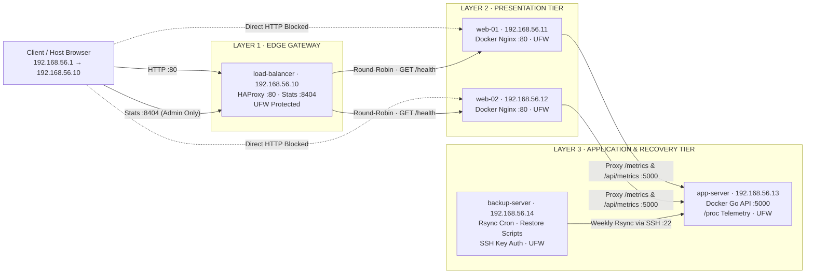

# Infrastructure Insight - Multi-Node Linux Telemetry Infrastructure

A highly available, multi-tier Linux infrastructure monitoring and diagnostic telemetry platform deployed across five virtual machines (VMs) using Vagrant, VirtualBox, Docker, HAProxy, Nginx, and Go.

---

## Documentation Links

| Document | Description | Link |
| :--- | :--- | :--- |
| **Project Overview & Architecture (This File)** | Objectives, scope, architecture, security, challenges, load balancing analysis, and verification steps. | [README.md](README.md) |
| **Project Guide & Demo Runbook** | Plain-language glossary, deep-dive engineering challenges, and live demonstration checklist. | [PROJECT_GUIDE.md](PROJECT_GUIDE.md) |
| **Vagrant Manifest** | Infrastructure-as-Code manifest provisioning all 5 VMs, Docker containers, UFW firewalls, and backup automation. | [vagrantfile](vagrantfile) |
| **HAProxy Configuration** | Layer 7 load balancing rules, `/health` probes, and environment-authenticated stats portal. | [haproxy.cfg](haproxy/haproxy.cfg) |
| **Nginx Configuration** | Static SPA serving, `/health` endpoint, dual `/metrics` & `/api/metrics` reverse proxy, and `X-Web-Server` header. | [nginx.conf](nginx/nginx.conf) |

---

## 1. Objectives, Scope, Requirements & Procedures

### 1.1 Objectives
- **High Availability:** Distribute web and API traffic across two containerized Nginx servers (`web-01` and `web-02`). If one node goes offline, HAProxy detects the `/health` failure and routes 100% of traffic to the surviving node with zero downtime.
- **Load Balancing:** Route incoming HTTP requests on `load-balancer` evenly across backend web servers using HAProxy `roundrobin` scheduling (with documented support for `leastconn`).
- **Zero-Trust Backend Isolation:** Enforce strict UFW firewall policies on every VM so clients cannot bypass the load balancer to hit `web-01`, `web-02`, or `app-server` directly.
- **Real-Time Telemetry & Proxy Security:** Serve live Linux `/proc` metrics (CPU load averages, physical memory, uptime) and accurately extract the real client IP via right-to-left `X-Forwarded-For` proxy chain traversal in Go.
- **Automated Provisioning & Disaster Recovery:** Provision the entire 5-node topology in a single `vagrant up` command and automate weekly SSH key-authenticated `rsync` backups with verified restoration.

---

### 1.2 Scope

| In-Scope | Out-of-Scope (Future Enhancements) |
| :--- | :--- |
| Five Ubuntu 22.04 VMs on an isolated private network | Cloud provider deployment (AWS, GCP, Azure) |
| HAProxy load balancer with HTTP health checks & protected stats | Dual load balancers with Keepalived active-passive failover |
| Two Dockerized Nginx web nodes serving SPA + reverse proxy | TLS/SSL certificates & HTTPS termination (Port 443) |
| Dockerized Go telemetry API parsing Linux `/proc` metrics | Long-term time-series database (Prometheus / Grafana) |
| Default-deny UFW firewalls isolating every network tier | Ansible configuration management pipelines |
| Automated weekly `rsync` backup, 30-day retention & restore script | Automated CI/CD container registry pipelines |

---

### 1.3 System Requirements

#### Host Computer:
- **Operating System:** Windows 10/11, macOS, or Linux.
- **CPU:** Minimum 4 CPU cores with hardware virtualization (VT-x / AMD-V) enabled in BIOS.
- **RAM:** At least 8 GB total system memory (the 5 VMs allocate 3,072 MB / ~3.0 GB total).
- **Disk Space:** At least 20 GB of free storage.

#### Software Prerequisites:
- **Oracle VirtualBox:** Version 7.0 or newer.
- **HashiCorp Vagrant:** Version 2.3 or newer.
- **Go:** Version 1.24+ (optional on host, required only if running Go unit tests locally outside Docker).
- **OpenSSH / `curl.exe`:** Built into modern Windows PowerShell, macOS, and Linux.

#### Network Addressing:
All five virtual machines communicate over an isolated VirtualBox host-only subnet (`192.168.56.0/24`):
- `192.168.56.10` ➔ **`load-balancer`** (HAProxy Edge Gateway)
- `192.168.56.11` ➔ **`web-01`** (Docker + Nginx Presentation Tier 1)
- `192.168.56.12` ➔ **`web-02`** (Docker + Nginx Presentation Tier 2)
- `192.168.56.13` ➔ **`app-server`** (Docker + Go Telemetry Backend API)
- `192.168.56.14` ➔ **`backup-server`** (SSH Key-Based Rsync Backup & Restore Host)

---

### 1.4 Operating Procedures

#### Step 1: Configure Local Environment Variables
Before launching the cluster, ensure a local `.env` file (ignored by Git) exists in the project root with your HAProxy stats credentials (`HAPROXY_STATS_USER` and `HAPROXY_STATS_PASSWORD`):
```ini
HAPROXY_STATS_USER=admin
HAPROXY_STATS_PASSWORD=your_secure_password
```

#### Step 2: Starting the Environment
Open PowerShell in the project root directory and provision all five VMs:
```powershell
vagrant up
vagrant status
```
Vagrant automatically provisions VMs in dependency order:
1. Boots `backup-server` first to generate the 2048-bit RSA SSH keypair (`id_rsa`) and install backup/restore scripts.
2. Provisions `load-balancer` with HAProxy, environment-injected stats auth (`/etc/default/haproxy`), and UFW rules.
3. Builds and starts the Dockerized Nginx containers (`--hostname web-01` and `web-02`) on port `80`.
4. Compiles and starts the multi-stage Dockerized Go backend container on `app-server:5000` and authorizes `backup-server`'s public key.

#### Step 3: Verifying Traffic Routing
Execute sequential HTTP requests against the load balancer from the host:
```powershell
for ($i=1; $i -le 4; $i++) { curl.exe -sI http://192.168.56.10/ | Select-String "X-Web-Server" }
```
*The `X-Web-Server` header alternates evenly between `web-01` and `web-02`.*

#### Suspending, Halting, and Removing:
```powershell
# Suspend all VMs to preserve state while saving CPU and RAM:
vagrant suspend

# Resume suspended VMs:
vagrant resume

# Gracefully shut down all VMs:
vagrant halt

# Completely destroy all VMs and free disk space:
vagrant destroy -f
```

---

## 2. System Architecture

### 2.1 Architecture Diagrams

#### Interactive Component Diagram:


#### Network Topology Diagram:
```text
                             +---------------------------------------+
                             |        Host Machine (192.168.56.1)    |
                             |   Browser / curl.exe → 192.168.56.10  |
                             +-------------------+-------------------+
                                                 |
                                                 | HTTP :80 (Public) / Stats :8404 (Admin IP Only)
                                                 v
                             +---------------------------------------+
                             |             load-balancer             |
                             |             192.168.56.10             |
                             |        (HAProxy L7 + UFW Rules)       |
                             +-------------------+-------------------+
                                                 |
                        +------------------------+------------------------+
                        | (Round-Robin via 192.168.56.10)                 | (Round-Robin via 192.168.56.10)
                        v                                                 v
         +-----------------------------+                   +-----------------------------+
         |           web-01            |                   |           web-02            |
         |        192.168.56.11        |                   |        192.168.56.12        |
         |   (Docker Nginx + SPA)      |                   |   (Docker Nginx + SPA)      |
         | [UFW: Only 192.168.56.10:80]|                   | [UFW: Only 192.168.56.10:80]|
         +--------------+--------------+                   +--------------+--------------+
                        |                                                 |
                        +------------------------+------------------------+
                                                 |
                                                 | Reverse Proxy :5000 (/metrics & /api/metrics)
                                                 v
         +-----------------------------+                   +-----------------------------+
         |         app-server          |  SSH :22 (Rsync)  |        backup-server        |
         |        192.168.56.13        | <================ |        192.168.56.14        |
         | (Docker Go Telemetry API)   |   Weekly 02:00    | (Rsync + 30-Day Retention)  |
         | [UFW: :5000 from web-01/02] |                   |  [UFW: Default Deny + :22]  |
         +-----------------------------+                   +-----------------------------+
```

### 2.2 Request Routing & Telemetry Flow
1. **Client Request:** A user opens `http://192.168.56.10` or curls `/metrics` or `/api/metrics`.
2. **Health Evaluation & Balancing:** HAProxy continuously monitors `/health` on both web nodes (`expect status 200`). Traffic is distributed via `roundrobin` only to healthy instances.
3. **Web Tier Firewall & Reverse Proxy:** `web-01` or `web-02` accepts port 80 exclusively from `192.168.56.10`, injects `X-Web-Server: web-01` (or `web-02`), serves the dashboard UI, and proxies `/metrics` or `/api/metrics` to `192.168.56.13:5000/metrics`.
4. **Backend Telemetry & Proxy Chain Resolution:** The Go container on `app-server` reads live Linux kernel stats from `/proc/meminfo`, `/proc/loadavg`, and `/proc/uptime`, walks `X-Forwarded-For` right-to-left past trusted proxies (`192.168.56.10`, `.11`, `.12`) to extract the authentic client IP (`192.168.56.1`), and returns JSON telemetry.
5. **Auto-Refresh:** The frontend dashboard polls `/api/metrics` every 30 seconds (`AUTO_REFRESH_INTERVAL_MS = 30000`) and plots a live CPU load sparkline chart.

---

## 3. Node Inventory, Resource Sizing & Metrics API Contract

### 3.1 VM Inventory

| VM Name | IP Address | RAM | vCPUs | Role | Installed Services |
| :--- | :--- | :--- | :--- | :--- | :--- |
| **`backup-server`** | `192.168.56.14` | 512 MB | 1 | Backup & disaster recovery host | `rsync`, Cron (`weekly-devops-backup`), SSH keypair, UFW |
| **`load-balancer`** | `192.168.56.10` | 512 MB | 1 | Reverse proxy & edge gateway | HAProxy (`:80`, `:8404`), `/etc/default/haproxy` auth, UFW |
| **`web-01`** | `192.168.56.11` | 512 MB | 1 | Primary web presentation node | Docker, Nginx container (`frontend:0.2`), UFW |
| **`web-02`** | `192.168.56.12` | 512 MB | 1 | Redundant web presentation node | Docker, Nginx container (`frontend:0.2`), UFW |
| **`app-server`** | `192.168.56.13` | 1024 MB | 1 | Backend telemetry application tier | Docker, Go API container (`backend:latest`), UFW |

### Resource Allocation Rationale:
- HAProxy, Nginx (Alpine-based), and Rsync are lightweight event-driven/CLI utilities that operate comfortably under 100 MB RAM, making **512 MB** sufficient with healthy OS headroom.
- `app-server` is allocated **1024 MB** to run the Go multi-stage Docker build (`golang:1.24.5-alpine` builder → `alpine:3.19` runtime) smoothly without OOM pressure.
- Total memory footprint across all five VMs is **3,072 MB (~3.0 GB)**, keeping host overhead low.

### 3.2 Metrics API Contract

Both `/metrics` and `/api/metrics` return the identical JSON contract:

```json
{
  "server": {
    "hostname": "app-server",
    "os": "linux",
    "architecture": "amd64",
    "uptimeSeconds": 12345.67
  },
  "cpu": {
    "cores": 1,
    "loadAverage1": 0.02,
    "loadAverage5": 0.05,
    "loadAverage15": 0.08
  },
  "memory": {
    "appUsedMB": 4,
    "systemTotalMB": 1024,
    "systemAvailableMB": 512,
    "usagePercent": 50.0
  },
  "clientIP": "192.168.56.1"
}
```

* **`X-Web-Server` Response Header:** Injected by Nginx using container hostname (`web-01` or `web-02`) to verify load balancer alternation.
* **CPU Load:** Reflects 1-, 5-, and 15-minute kernel run-queue length parsed from `/proc/loadavg`.
* **Memory:** `appUsedMB` reports active Go heap allocations (`runtime.MemStats.Alloc`), while `systemTotalMB` and `systemAvailableMB` reflect host RAM from `/proc/meminfo`.

---

## 4. Setup, Configuration & Engineering Challenges

> [!NOTE]
> For a plain-language glossary, detailed walkthrough of all engineering hurdles, and the live demonstration checklist, see:
>
> **[Project Guide & Demo Runbook (PROJECT_GUIDE.md)](PROJECT_GUIDE.md)**

### Summary of Key Challenges Solved
1. **Docker Build Context Mismatch:** `app/frontend/Dockerfile` needed access to both `nginx/nginx.conf` and `app/frontend/`. Building from `/vagrant` root (`docker build -f /vagrant/app/frontend/Dockerfile -t frontend:0.2 /vagrant`) resolved the `file not found` errors.
2. **Nginx Route Alignment (`/metrics` vs `/api/metrics`):** Frontend JS requested `/api/metrics` while automated checks queried `/metrics`. Defining explicit exact-match location blocks (`location = /api/metrics` and `location = /metrics`) eliminated Nginx regex compilation constraints and served identical JSON on both routes.
3. **HAProxy in the Trusted Proxy Chain:** Initially, `getClientIP()` saw HAProxy (`192.168.56.10`) as an untrusted client. Adding `192.168.56.10` to `TRUSTED_PROXIES` and walking `X-Forwarded-For` right-to-left correctly isolated the real user IP (`192.168.56.1`) while defending against spoofed client headers.
4. **Vagrant Provisioning Order & SSH Timing:** Moved `backup-server` first in `vagrantfile` so its RSA keypair exists before `app-server` provisions, and added `ssh-keyscan` to eliminate insecure `StrictHostKeyChecking=no`.
5. **Identifying Dockerized Web Nodes:** Docker assigns random container IDs as hostnames by default. Injecting `--hostname #{server[:name]}` into `docker run` enabled `X-Web-Server: web-01` / `web-02`.

---

## 5. Security & Backup Measures Implemented

The cluster implements defense-in-depth across networking, application logic, secrets, and disaster recovery:

1. **Private Subnet Isolation:** All inter-VM communication stays inside the isolated host-only subnet (`192.168.56.0/24`).
2. **Default-Deny Host Firewalls (UFW):** Active on every VM (`ufw default deny incoming`):
   * `load-balancer`: Allows `80/tcp` (web) and restricts `8404/tcp` (stats) **only** to the admin workstation (`192.168.56.1`).
   * `web-01` & `web-02`: Allow `80/tcp` **only** from `192.168.56.10` (direct external HTTP requests time out).
   * `app-server`: Allows `5000/tcp` **only** from `192.168.56.11` and `192.168.56.12`; allows `22/tcp` from `192.168.56.14`.
   * `backup-server`: Denies all incoming ports except `22/tcp`.
3. **Environment-Backed Secrets (`.env`):** HAProxy stats credentials are stored in a gitignored `.env` file, loaded dynamically by `vagrantfile`, and written to `/etc/default/haproxy`—never hardcoded in public Git commits.
4. **Strict Go Configuration & Header Validation:** Startup config enforces character-by-character port/IP validation on `LISTEN_ADDR` (1–65535), strict HTTP/HTTPS origin validation for CORS (`ALLOWED_ORIGINS`), and right-to-left proxy traversal (`TRUSTED_PROXIES`).
5. **Key-Authenticated Automated Backup & Disaster Recovery:**
   * Cron job (`/etc/cron.d/weekly-devops-backup`) runs `/usr/local/bin/backup-devops.sh` every **Sunday at 02:00**.
   * Uses passwordless 2048-bit RSA SSH keys (`id_rsa`) and `ssh-keyscan` known-host verification.
   * Synchronizes `/home/devops` and `/etc/hosts` with `--delete`, creates timestamped `.tar.gz` archives in `/var/backups/devops`, and prunes snapshots older than **30 days**.
   * Includes `/usr/local/bin/restore-devops.sh` for one-command disaster recovery to `app-server`.

> [!NOTE]
> **Known Limitation & Production Hardening Note (`vagrant` User Management):**
> In this local VirtualBox lab, the default `vagrant` user remains enabled with its local key so Vagrant CLI orchestration (`vagrant ssh`, `vagrant halt`, `vagrant provision`) functions cleanly. In production, provisioning keys would be revoked by adding `AllowUsers devops` and disabling password auth in `/etc/ssh/sshd_config`.

---

## 6. Load Balancing Comparison: Round-Robin vs. Least Connections

HAProxy is configured with **Round-Robin** (`balance roundrobin`) by default.

### Live Test Evidence (Round-Robin)
Six sequential `curl.exe` requests demonstrate exact 50/50 alternating distribution:
```text
X-Web-Server: web-01
X-Web-Server: web-02
X-Web-Server: web-01
X-Web-Server: web-02
X-Web-Server: web-01
X-Web-Server: web-02
```

### Comparative Analysis

| Criteria | Round-Robin (`roundrobin`) [Active] | Least Connections (`leastconn`) |
| :--- | :--- | :--- |
| **Routing Logic** | Distributes requests sequentially: A -> B -> A -> B. | Routes to the backend server with the fewest active TCP connections. |
| **Ideal Workload** | Short, stateless, uniform HTTP requests (SPAs, static files, fast REST JSON APIs). | Long-lived sessions, WebSockets, streaming telemetry, or slow database queries. |
| **Server Utilization** | Assumes equivalent node capacity and response latency. | Dynamically shifts traffic away from overloaded or slower nodes. |
| **Verdict for This Project** | **Optimal:** Dashboard assets and `/proc` JSON responses complete in < 5ms. | Useful upgrade if long-lived WebSocket streaming is added later. |

To switch to **Least Connections**, update `balance roundrobin` to `balance leastconn` in [haproxy.cfg](haproxy/haproxy.cfg) and reload:
```powershell
vagrant ssh load-balancer -c "sudo systemctl reload haproxy"
```

---

## 7. Recommendations for Future Improvements & Maintenance

### 7.1 Architecture Improvements
1. **Redundant Load Balancer (Keepalived VRRP Failover):** Add a second HAProxy VM (`load-balancer-02`) sharing a Virtual IP (`192.168.56.9`) via Keepalived so even a load-balancer outage fails over in < 1 second.
2. **HTTPS / TLS Termination (Port 443):** Terminate TLS certificates at HAProxy on port 443 and redirect HTTP (`:80`) traffic to HTTPS.
3. **Centralized Observability Stack:** Export `/metrics` into Prometheus and build Grafana dashboards alongside centralized log aggregation (Grafana Loki).
4. **Ansible Playbook Provisioning:** Refactor inline Vagrant shell blocks into modular Ansible roles for repeatable cloud/bare-metal deployments.
5. **Non-Root Container Hardening:** Run Nginx and Go binaries as unprivileged non-root users with read-only container root filesystems (`--read-only`).

### 7.2 Maintenance Schedule

| Interval | Task | Command | Purpose |
| :--- | :--- | :--- | :--- |
| **Weekly** | Verify Backup Execution | `vagrant ssh backup-server -c "ls -lh /var/backups/devops"` | Confirm weekly cron archives are being generated |
| **Weekly** | Audit Firewall Policies | `vagrant ssh load-balancer -c "sudo ufw status verbose"` | Ensure port restrictions remain enforced |
| **Monthly** | Run Go Test Suite | `cd app/backend && go test -v -count=1 ./...` | Verify code integrity after configuration updates |
| **Monthly** | Save Cluster Snapshot | `vagrant snapshot save <name>` | Maintain point-in-time VM recovery points |

---

## 8. Verification and Testing

### 1. Test Load Balancing (Round-Robin Alternation):
```powershell
for ($i=1; $i -le 6; $i++) { curl.exe -sI http://192.168.56.10/ | Select-String "X-Web-Server" }
```

### 2. Test Backend Isolation (UFW Firewall Check):
```powershell
curl.exe --connect-timeout 2 http://192.168.56.11
curl.exe --connect-timeout 2 http://192.168.56.12
# Expected: curl: (28) Connection timed out
```

### 3. Test Both Metrics API Endpoints:
```powershell
curl.exe -i http://192.168.56.10/metrics
curl.exe -i http://192.168.56.10/api/metrics
# Expected: Both return HTTP/1.1 200 OK with valid JSON telemetry
```

### 4. Test Automated Failover:
```powershell
# Simulate web-01 container failure
vagrant ssh web-01 -c "sudo docker pause frontend"
curl.exe -sI http://192.168.56.10/ | Select-String "X-Web-Server"
# Expected: 100% of traffic routes seamlessly to web-02

# Restore web-01
vagrant ssh web-01 -c "sudo docker unpause frontend"
```

### 5. Verify Backup & Disaster Recovery:
```powershell
vagrant ssh backup-server -c "sudo /usr/local/bin/backup-devops.sh"
vagrant ssh backup-server -c "sudo /usr/local/bin/restore-devops.sh"
```

### 6. Run Go Backend Unit Tests & Static Analysis:
```powershell
cd app/backend
go test -v -count=1 ./...
go vet ./...
```
All 11 test suites (covering environment validation, `/proc` parsing, right-to-left proxy security, CORS middleware, and `/metrics` JSON contract) pass with zero warnings.

> [!TIP]
> Consult the [Project Guide & Demo Runbook](PROJECT_GUIDE.md) for the complete video demonstration script and expected command outputs.
