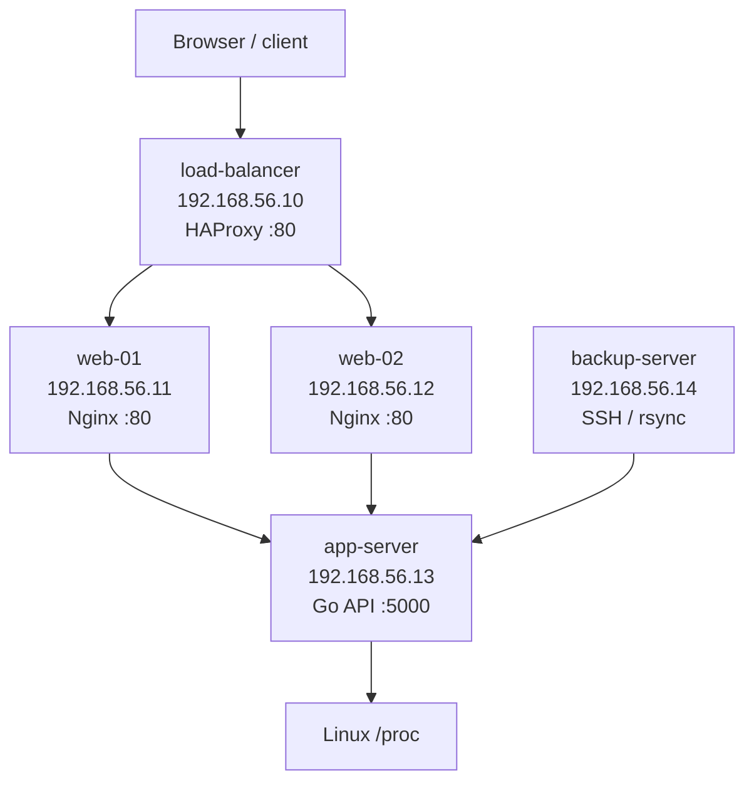

# Infrastructure Insight

## Multi-Node Linux Telemetry Infrastructure

Infrastructure Insight is a DevOps learning project that builds a local, multi-tier Linux environment across five virtual machines (VMs). It combines Vagrant and VirtualBox for infrastructure, Docker for application packaging, HAProxy for traffic distribution, Nginx for the web tier, and a Go API for Linux system metrics.

The project is intended to demonstrate practical infrastructure concepts: provisioning, service deployment, reverse proxying, load balancing, network isolation, monitoring, backup and recovery, and troubleshooting.

---

## Documentation

| Document | Purpose |
| :--- | :--- |
| [README.md](README.md) | Project overview, architecture, setup, engineering challenges, security, and verification |
| [PROJECT_GUIDE.md](PROJECT_GUIDE.md) | Plain-language glossary, deeper explanations, and demonstration runbook |
| [vagrantfile](vagrantfile) | Vagrant infrastructure definition |
| [haproxy/haproxy.cfg](haproxy/haproxy.cfg) | HAProxy frontend, backend, health checks, and statistics configuration |
| [nginx/nginx.conf](nginx/nginx.conf) | Nginx static-file serving and API reverse-proxy configuration |

---

## 1. Project Goals and Scope

### 1.1 Goals

- **Multi-VM infrastructure:** Provision five Ubuntu VMs on a private VirtualBox network.
- **Traffic distribution:** Use HAProxy as the single HTTP entry point and distribute requests between `web-01` and `web-02`.
- **Web tier:** Run Nginx in Docker containers to serve the frontend and proxy API requests.
- **Application tier:** Run a containerized Go API on `app-server`.
- **Linux telemetry:** Read selected Linux system information from `/proc` and expose it as JSON through the Go API.
- **Network controls:** Use UFW rules to restrict which machines can reach services and ports.
- **Backup and recovery:** Use SSH-key-authenticated `rsync` and scheduled backup scripts on the backup VM.
- **Learning and verification:** Test service availability, request routing, API responses, firewall behavior, and recovery procedures.

### 1.2 Current Scope and Future Scope

| Current Project Scope | Future Enhancements |
| :--- | :--- |
| Five Ubuntu VMs on a private network (`192.168.56.0/24`) | Deployment to AWS, Azure, or Google Cloud |
| HAProxy HTTP entry point and web-node health checks | A second load balancer with Keepalived failover |
| Two Dockerized Nginx web nodes | HTTPS/TLS termination and certificate automation |
| Dockerized Go telemetry API reading selected `/proc` values | Prometheus, Node Exporter, and Grafana for all five VMs |
| UFW network restrictions | More detailed firewall review and automated security tests |
| Backup scripts using SSH and `rsync` | Off-site backups and regular automated restore tests |
| Manual/local image build and deployment workflow | CI/CD pipeline and a container registry |
| HAProxy round-robin balancing | Rate limiting and additional abuse-protection controls |
| Vagrant provisioning | Ansible-based configuration management |

### 1.3 Important Architecture Limitations

The project has one HAProxy VM. HAProxy can route around an unhealthy web node when its health checks are configured and working, but the load balancer itself remains a single point of failure (SPOF). A second load balancer and a failover mechanism would be needed to remove that single point of failure.

Likewise, monitoring the Go API on `app-server` does not automatically mean that all five VMs are monitored. Centralized monitoring of every VM is a separate future enhancement described in the Roadmap.

---

## 2. Requirements

### 2.1 Host Computer

- Windows 10/11, macOS, or Linux.
- Hardware virtualization enabled (Intel VT-x or AMD-V).
- At least 4 CPU cores recommended.
- At least 8 GB host RAM recommended.
- At least 20 GB free disk space recommended.

The five VMs are configured with approximately 3 GB of guest RAM in total. The host operating system and VirtualBox also need memory, so actual resource requirements depend on what else is running on the host.

### 2.2 Software

- Oracle VirtualBox 7.0 or newer.
- HashiCorp Vagrant 2.3 or newer.
- Docker in the environment used to build images and on target VMs as required by the provisioning workflow.
- OpenSSH.
- `curl` (`curl.exe` in Windows PowerShell).
- Go 1.24 or newer if running backend tests locally outside Docker.

Check the versions installed on your machine before starting. Compatibility can depend on the versions of VirtualBox and Vagrant.

### 2.3 VM Network

The VMs use the private host-only subnet `192.168.56.0/24`.

| VM | Private IP | Main Responsibility | Planned Service Ports |
| :--- | :--- | :--- | :--- |
| `load-balancer` | `192.168.56.10` | HAProxy entry point | TCP 80; TCP 8404 for restricted HAProxy statistics, if enabled |
| `web-01` | `192.168.56.11` | Nginx frontend and API proxy | TCP 80 |
| `web-02` | `192.168.56.12` | Nginx frontend and API proxy | TCP 80 |
| `app-server` | `192.168.56.13` | Go telemetry API | TCP 5000 |
| `backup-server` | `192.168.56.14` | Backup and restore host | TCP 22 for SSH-based backup access |

The table describes the intended service ports. Confirm the actual listening sockets and firewall rules on each VM before relying on them.

---

## 3. Architecture

### 3.1 High-Level Request Flow

```text
Browser / curl
      |
      | HTTP :80
      v
load-balancer (192.168.56.10)
HAProxy
      |
      +-----------------------+
      |                       |
      v                       v
web-01 (192.168.56.11)     web-02 (192.168.56.12)
Nginx + frontend           Nginx + frontend
      |                       |
      +-----------+-----------+
                  |
                  | API reverse proxy to :5000
                  v
         app-server (192.168.56.13)
         Dockerized Go telemetry API
                  |
                  v
         Linux information in /proc

backup-server (192.168.56.14)
      |
      | SSH / rsync on TCP 22
      v
app-server backup source
```

### 3.2 Mermaid Component Diagram



### 3.3 Request Flow

1. A browser sends an HTTP request to the HAProxy address, `192.168.56.10`.
2. HAProxy selects a healthy web node according to its configured balancing algorithm (`roundrobin`).
3. Nginx on that web node serves the frontend files.
4. For `/metrics` or `/api/metrics`, Nginx proxies the request to the Go API on `app-server:5000`.
5. The Go API reads the Linux information available to its process and returns a JSON response.
6. The frontend requests the API periodically and updates the dashboard.

The frontend's relative API path is important. A browser-side URL such as `http://localhost:5000/metrics` would refer to the user's own computer, not the remote app server.

### 3.4 What the Current Metrics Do and Do Not Represent

The Go API reads Linux information from the environment in which the backend runs. When the backend runs in a container on `app-server`, its metrics describe the Linux environment visible to that container. They should not be described as metrics for all five VMs.

To monitor every VM centrally, deploy a host-level metrics exporter (for example, Node Exporter) on each VM and configure a central Prometheus server to collect those metrics. Grafana can then visualize the collected data. This is a future enhancement, not part of the current Go API unless separately implemented and verified.

---

## 4. VM Resources and Application Contract

### 4.1 Resource Allocation

| VM | RAM | vCPU | Role |
| :--- | :--- | :--- | :--- |
| `load-balancer` | 512 MB | 1 | HAProxy |
| `web-01` | 512 MB | 1 | Docker and Nginx |
| `web-02` | 512 MB | 1 | Docker and Nginx |
| `app-server` | 1024 MB | 1 | Docker and Go API |
| `backup-server` | 512 MB | 1 | SSH, rsync, scheduled backup |
| **Total** | **3072 MB** | **5** | |

These are the configured guest allocations described for this lab. Actual memory use should be measured during operation; do not assume that a service always stays below a particular memory limit.

### 4.2 Metrics API

The API exposes `/metrics`. The Nginx configuration also exposes `/api/metrics` as a browser-facing route to the same backend endpoint.

Example response shape:

```json
{
  "server": {
    "hostname": "app-server",
    "os": "linux",
    "architecture": "amd64",
    "uptimeSeconds": 12345.67
  },
  "cpu": {
    "cores": 1,
    "loadAverage1": 0.02,
    "loadAverage5": 0.05,
    "loadAverage15": 0.08
  },
  "memory": {
    "appUsedMB": 4,
    "systemTotalMB": 1024,
    "systemAvailableMB": 512,
    "usagePercent": 50.0
  },
  "clientIP": "192.168.56.1"
}
```

The values above are illustrative, not live measurements.

- `server.hostname`, `os`, and `architecture` describe the environment reported by the Go process.
- `cpu.loadAverage1`, `cpu.loadAverage5`, and `cpu.loadAverage15` represent Linux load averages over the stated periods. Load average is not the same as CPU utilization percentage.
- `memory.appUsedMB` represents Go application/runtime memory as implemented.
- `memory.systemTotalMB` and `memory.systemAvailableMB` are read from Linux memory information.
- `clientIP` depends on the trusted proxy configuration and forwarded headers.

---

## 5. Ports and Docker Networking

Understanding ports is essential when deploying and troubleshooting this infrastructure.

### 5.1 Main Ports

| Port | Typical Use in this Project | Notes |
| :--- | :--- | :--- |
| 22/TCP | SSH | Remote administration and SSH-based backup |
| 80/TCP | HTTP | HAProxy entry point and Nginx web service |
| 443/TCP | HTTPS | Future TLS enhancement unless configured separately |
| 5000/TCP | Go backend API | Intended to be reachable from the web VMs |
| 8404/TCP | HAProxy statistics | Restrict to authorized administrators if enabled |
| 9100/TCP | Node Exporter | Possible future monitoring port; not part of current setup unless installed |

A port number is not proof that a service is running. Check the actual listening sockets on the relevant machine.

### 5.2 Understanding Docker Port Mapping

For a command such as:

```bash
docker run -d --name backend -p 5000:5000 backend:latest
```

The syntax is:

```text
-p HOST_PORT:CONTAINER_PORT
```

- The first `5000` is the port on the VM (the Docker host).
- The second `5000` is the port inside the container where the Go application listens.

Docker forwards traffic received on the host port to the container port.

For example:

```bash
docker run -d --name backend -p 5001:5000 backend:latest
```

This maps VM port `5001` to container port `5000`. The Go application can continue listening on port `5000` inside the container. Any Nginx upstream or firewall rule that targets the host port must be updated consistently if the host-side port changes.

### 5.3 Checking Listening Ports on Linux

Show listening TCP/UDP sockets and, where permissions allow, the associated process:

```bash
sudo ss -tulnp
```

Useful option meanings:

- `-t`: TCP
- `-u`: UDP
- `-l`: listening sockets
- `-n`: numeric addresses and port numbers
- `-p`: process information

Filter for a specific port:

```bash
sudo ss -tulnp | grep ':5000'
```

Identify a process by PID:

```bash
ps -p <PID> -f
```

Another useful command is:

```bash
sudo lsof -i :5000
```

Test whether a remote TCP port is reachable:

```bash
nc -zv 192.168.56.13 5000
```

These commands answer different questions:
- `ss` checks sockets on the machine where the command runs.
- `lsof` helps identify processes using a port.
- `nc` tests whether a connection to a remote host and port can be made.

### 5.4 Troubleshooting a Port Conflict

If Docker reports `address already in use` when publishing a host port:

1. Check the host's listening sockets with `sudo ss -tulnp`.
2. Identify the process and understand why it is using the port.
3. Check existing containers with `docker ps` and `docker ps -a`.
4. Decide whether the existing service should remain running.
5. If appropriate, stop or reconfigure the conflicting service, or choose another host port.
6. Update related Nginx upstream and UFW rules if the host port changes.
7. Retry and verify the service.

Do not kill an unknown process just to free a port. Identify it first. Two services normally cannot bind to the same IP address, port, and protocol combination.

---

## 6. Setup and Operating Procedures

The commands below describe the intended workflow. Confirm that they match the current `vagrantfile`, image tags, shared-folder configuration, and target VM state before running them.

### 6.1 Configure Local Environment Variables

If HAProxy statistics authentication is configured through environment variables, create a local `.env` file in the project root and ensure it is excluded by `.gitignore`.

Example only:

```ini
HAPROXY_STATS_USER=admin
HAPROXY_STATS_PASSWORD=replace_with_a_strong_unique_password
```

Do not commit real credentials, private keys, or tokens.

### 6.2 Start and Inspect the VMs

From PowerShell in the directory containing the Vagrantfile:

```powershell
vagrant up
vagrant status
```

If provisioning is designed to run automatically, Vagrant should configure the VMs. Inspect the provisioning output and verify each VM rather than assuming that a successful `vagrant up` proves every application is healthy.

### 6.3 Inspect Containers

Connect to the relevant VM and inspect its containers:

```powershell
vagrant ssh app-server
```

Then, inside the VM:

```bash
docker ps
docker ps -a
docker logs backend
```

Use the corresponding VM and container name for the web nodes.

### 6.4 Stop, Suspend, Resume, or Destroy the Environment

From the host in the project directory:

```powershell
# Suspend VMs and preserve their state
vagrant suspend

# Resume suspended VMs
vagrant resume

# Gracefully shut down VMs
vagrant halt

# Destroy the VMs
vagrant destroy -f
```

`vagrant destroy` removes the Vagrant-managed VMs. Make sure you have any data you need before destroying them.

---

## 7. Engineering Challenges and Lessons Learned

This section records concrete problems encountered during development and the reasoning used to solve them.

### 7.1 Docker Build-Context Mismatch

**Problem:** The frontend Dockerfile needed files from both `app/frontend/` and `nginx/`. Building with the wrong Docker build context caused `COPY` instructions to fail because Docker could not see files outside the selected context.

**Lesson:** The Docker build context is the directory whose files are available to `COPY` and `ADD`. The `-f` option selects the Dockerfile; it does not automatically change the build context.

**Example pattern:**

```bash
docker build -f app/frontend/Dockerfile -t frontend:0.2 .
```

Run this from the repository root if the Dockerfile expects both the frontend and Nginx directories to be available there.

### 7.2 Aligning Nginx Routes

**Problem:** The frontend requested `/api/metrics`, while some manual or automated checks used `/metrics`.

**Approach:** Configure Nginx location rules deliberately so the intended routes reach the backend correctly. Test both paths and confirm that they return the expected response.

**Lesson:** Frontend URLs, Nginx locations, backend routes, and test commands must agree.

### 7.3 Understanding the Forwarded Client IP

**Problem:** When a request passes through HAProxy and Nginx, the Go backend may see the address of the last proxy rather than the original client.

**Approach:** Configure forwarding headers consistently and trust only known proxy addresses. The Go application should parse the proxy chain using a clearly defined trust policy.

**Security lesson:** Do not blindly trust an arbitrary client-supplied `X-Forwarded-For` header. A client may try to spoof it. Only accept forwarded information from proxies you control, and test the behavior with both trusted and untrusted sources.

### 7.4 Vagrant Provisioning Order and SSH Readiness

**Problem:** A VM that needs an SSH public key cannot be configured correctly until the VM generating that key has completed the relevant setup.

**Approach:** Make provisioning dependencies explicit and wait for SSH readiness before attempting key-based operations.

**Lesson:** Provisioning order and service readiness are different concerns. A VM being powered on does not necessarily mean its services are ready.

### 7.5 Identifying Dockerized Web Nodes

**Problem:** Containers may have generated hostnames or identifiers that are not useful for distinguishing `web-01` from `web-02`.

**Approach:** Assign meaningful container hostnames or configure an explicit response header such as `X-Web-Server`.

**Lesson:** Observability is easier when each instance has a stable, recognizable identity.

### 7.6 Port Selection and Port Conflicts

**Problem:** A container may fail to start if its requested host port is already in use.

**Approach:** Inspect listening sockets with `ss`, identify the process, inspect running containers, and then decide whether to stop the existing service or choose another host port.

**Lesson:** In Docker's `-p HOST_PORT:CONTAINER_PORT` mapping, the host port and container port have separate roles. Changing one may require updating firewall rules or reverse-proxy destinations.

### 7.7 Distinguishing Image Build from Container Deployment

**Problem:** Building a Docker image does not mean the application is running on the target VM.

**Approach:** Transfer or make the image available on the target VM, load it if necessary, create and start the container, then inspect its status and logs and test the service endpoint.

**Lesson:** An image is a packaged template; a container is a running (or stopped) instance created from that image.

---

## 8. Security and Backup Considerations

The following controls are described for this lab. Verify the actual firewall, HAProxy, SSH, and backup configurations before treating them as active protections.

### 8.1 Network Restrictions

The intended UFW policy is default-deny for incoming traffic, with narrowly scoped allowances:

- `load-balancer`: HTTP on TCP 80; HAProxy statistics on TCP 8404 only from the authorized administration address, if enabled.
- `web-01` and `web-02`: TCP 80 only from the load balancer.
- `app-server`: TCP 5000 only from the web nodes; SSH access only as required for administration and backup.
- `backup-server`: SSH access only as required.

Check each VM with:

```bash
sudo ufw status verbose
```

A firewall rule should be tested from both an allowed source and a disallowed source.

### 8.2 HAProxy Statistics and Credentials

If the HAProxy statistics page is enabled, protect it with authentication and network restrictions. Do not expose an administrative statistics endpoint to untrusted networks.

Store secrets outside tracked source files. Check `.gitignore` and the Git history to ensure that credentials have not been committed.

### 8.3 Proxy Headers and Client Identity

Forwarded headers are useful for tracing the original client through multiple proxies, but they are not automatically trustworthy. The backend must use an explicit trusted-proxy list and reject or ignore untrusted forwarded information.

### 8.4 Backup and Restore

The described backup workflow uses SSH key authentication and `rsync`, with scheduled backups and retention. A backup is not proven useful until restoration has been tested.

Recommended checks:
- Confirm the scheduled job exists and runs.
- Inspect backup timestamps and file sizes.
- Review backup logs and exit codes.
- Restore to a safe test location before relying on a recovery procedure.
- Protect private keys and backup contents.
- Confirm that the backup includes the data and configuration actually required for recovery.

The described backup paths and retention settings should be checked against the current scripts before use.

### 8.5 Lab Versus Production

This is a local learning environment, not a production-hardened deployment. Production would require a broader review of identity and access management, patching, secrets, TLS, firewall policy, logging, monitoring, backup isolation, recovery objectives, and high availability.

---

## 9. Load-Balancing Concepts

### 9.1 Round-Robin

Round-robin distributes new requests in rotation across available backend servers. With two equally configured web nodes, a simple sequence may look like:

```text
Request 1 -> web-01
Request 2 -> web-02
Request 3 -> web-01
Request 4 -> web-02
```

This is a scheduling example, not a guarantee that every real-world workload will be exactly 50/50. Persistent connections, health status, and request behavior can affect observed distribution.

### 9.2 Why Round-Robin was Chosen Over Least Connections

Infrastructure Insight actively uses **Round-Robin** (`balance roundrobin`) because our telemetry dashboard and `/api/metrics` requests are stateless, uniform, and complete in under 5 milliseconds. Under uniform workloads, Round-Robin provides predictable, deterministic distribution with zero computational overhead.

**Least Connections** (`balance leastconn`) chooses the backend with the fewest active TCP connections. While useful for workloads with unpredictable or long durations (such as WebSockets, file uploads, or complex database queries), it offers no advantage for fast, uniform API requests.

| Consideration | Round-Robin (`roundrobin`) [Active] | Least Connections (`leastconn`) [Alternative] |
| :--- | :--- | :--- |
| **Basic behavior** | Rotates sequentially across available servers (A → B → A → B) | Routes to the server with fewer active connections |
| **Ideal workload** | Short, uniform, stateless requests (our SPA assets and `/api/metrics`) | Long-lived connections, streaming telemetry, or variable database queries |
| **Main assumption** | Backend capacity and request processing times are broadly equal | Active connection count is a useful load signal |
| **Verdict for this project** | **Optimal:** Simple, zero overhead, and evenly balances fast telemetry requests | Alternative: Recommended only if the dashboard shifts to persistent WebSockets |

### 9.3 Health Checks and Failover

HAProxy can check backend health and stop sending new requests to a node that fails its configured health check. If `web-01` becomes unhealthy while `web-02` remains healthy, new traffic can be routed to `web-02`.

This protects against a web-node failure only when the health check correctly detects the failure and the remaining node can handle the traffic. It does not protect against failure of the single HAProxy VM.

### 9.4 Rate Limiting is a Separate Control

Load balancing distributes traffic; rate limiting controls how frequently a client or source can make requests.

Rate limiting can help reduce accidental overload and some forms of abusive traffic. It does not reveal a user's true intention and is not a substitute for authentication, authorization, input validation, logging, or network security.

Rate limiting is a future enhancement for this project, not a feature to claim as implemented unless it is configured and tested.

---

## 10. Future Improvements Roadmap

The following items are proposed improvements. They are not part of the current implementation unless subsequently built and verified.

### 10.1 Monitoring and Observability

- [ ] Install Node Exporter on each of the five VMs to expose host-level CPU, memory, disk, and network metrics.
- [ ] Deploy one central Prometheus server to scrape metrics from the exporters.
- [ ] Configure scrape targets and suitable scrape intervals.
- [ ] Learn and use PromQL to query and compare metrics.
- [ ] Add Grafana and connect it to Prometheus as a data source.
- [ ] Build dashboards for all five VMs.
- [ ] Add alerting for host unavailability, high resource use, and low disk space.
- [ ] Consider centralized log collection, for example with Grafana Loki.

**Proposed monitoring flow:**

```text
Linux VM 1 -> Node Exporter --+
Linux VM 2 -> Node Exporter --+
Linux VM 3 -> Node Exporter --+--> Prometheus --> Grafana dashboards
Linux VM 4 -> Node Exporter --+
Linux VM 5 -> Node Exporter --+
```

Node Exporter exposes host metrics; Prometheus collects and stores time-series data; Grafana visualizes the data. This is separate from the existing Go API, which currently reports metrics visible to the backend environment.

### 10.2 Traffic Management and Security

- [ ] Add and test HAProxy rate limiting with documented thresholds and behavior.
- [ ] Review authentication and authorization for administrative endpoints and any dashboard exposed beyond the trusted lab.
- [ ] Add request logging and a process for investigating unusual traffic.
- [ ] Add HTTPS/TLS termination at HAProxy and redirect HTTP to HTTPS.
- [ ] Review forwarded-header trust and client-IP handling.
- [ ] Consider a second HAProxy node with Keepalived for load-balancer failover.
- [ ] Review firewall rules and test allowed and denied paths systematically.

### 10.3 Automation and Delivery

- [ ] Move repeated provisioning tasks into Ansible roles.
- [ ] Add a CI pipeline for Go tests, static analysis, and Docker image builds.
- [ ] Consider a container registry and versioned image tags.
- [ ] Automate deployment and rollback.
- [ ] Pin base-image versions and plan regular security updates.

### 10.4 Application and Container Hardening

- [ ] Run application processes as non-root users where possible.
- [ ] Use read-only container filesystems where compatible.
- [ ] Drop unnecessary Linux capabilities.
- [ ] Add resource limits and health checks.
- [ ] Validate API inputs and HTTP methods.
- [ ] Expand automated tests and failure-handling tests.

### 10.5 Backup and Resilience

- [ ] Verify backup integrity automatically.
- [ ] Perform regular restore drills in an isolated test environment.
- [ ] Consider off-host or encrypted backup copies.
- [ ] Document recovery steps and expected recovery time.
- [ ] Test behavior when the backup server or a web node is unavailable.

---

## 11. Verification Checklist

Run checks from the correct environment. A successful command is evidence only for the specific behavior it tests.

### 11.1 Vagrant Status

```powershell
vagrant status
```

Confirm that the expected VMs are running.

### 11.2 Check Listening Ports on a VM

Connect to the VM and run:

```bash
sudo ss -tulnp
```

Check a particular port:

```bash
sudo ss -tulnp | grep ':5000'
```

### 11.3 Inspect Docker Containers

On the relevant VM:

```bash
docker ps
docker ps -a
docker logs backend
```

Use the correct container name for each service.

### 11.4 Test the Backend Directly

From a machine that is allowed to reach the app server (e.g. from `web-01` or `web-02`):

```bash
curl -i http://192.168.56.13:5000/metrics
```

Expected result: HTTP success and a valid JSON response, if the backend is running and the network policy permits the connection.

### 11.5 Test the Web Nodes and Load Balancer

```powershell
# Public HTTP entry point via HAProxy (accessible from host):
curl.exe -i http://192.168.56.10/health

# Direct requests to web-01 and web-02 from Windows host will time out by design due to UFW.
# To test backend web nodes directly, run from inside the load balancer:
vagrant ssh load-balancer -c "curl -i http://192.168.56.11/health"
vagrant ssh load-balancer -c "curl -i http://192.168.56.12/health"
```

The exact expected response depends on the configured health endpoint and HAProxy routing rules.

### 11.6 Test Load Balancing

If Nginx adds an `X-Web-Server` response header:

```powershell
for ($i=1; $i -le 6; $i++) {
    curl.exe -sI http://192.168.56.10/ | Select-String "X-Web-Server"
}
```

Check whether responses come from both web nodes. Do not assume exact alternation unless the observed output confirms it.

### 11.7 Test Both Metrics Routes

```powershell
curl.exe -i http://192.168.56.10/metrics
curl.exe -i http://192.168.56.10/api/metrics
```

Confirm that both routes return the intended JSON if both are configured.

### 11.8 Test a Web-Node Failure Carefully

Only perform failure tests in the local lab when you are ready to restore the service.

For example, pause the frontend container on `web-01`, test the load-balancer route, and then unpause it:

```powershell
vagrant ssh web-01 -c "sudo docker pause frontend"
curl.exe -i http://192.168.56.10/
vagrant ssh web-01 -c "sudo docker unpause frontend"
```

Confirm that HAProxy marks the failed node unhealthy and routes new requests to the remaining healthy node. Restore the paused container even if the test does not behave as expected.

### 11.9 Run Backend Tests

From the backend directory in an environment with the required Go version:

```bash
go test -v -count=1 ./...
go vet ./...
```

Record the actual test results when updating this README. Do not retain a test-count or success claim unless it matches the current code and test output.

---

## 12. Learning Outcomes

This project provides practical experience with:

- Linux server fundamentals and system metrics.
- Vagrant and VirtualBox multi-VM infrastructure.
- Docker images, containers, and port mapping.
- Go HTTP APIs and Linux `/proc` data.
- Nginx static hosting and reverse proxying.
- HAProxy load balancing and health checks.
- TCP ports, listening sockets, and network troubleshooting.
- UFW firewall rules and trusted proxy headers.
- SSH, `rsync`, scheduled backups, and recovery testing.
- Technical documentation and incremental infrastructure improvements.

---

**Project:** Infrastructure Insight  
**Author:** Mohan Thapa
